 

# Nikolas Opedal

**System &amp; full-stack developer** &middot; Haugesund, Norway

I build agentic platforms, developer tools, and the systems that hold them together.

---

### Building

&nbsp;

&nbsp;

---

### Stack

`languages` &nbsp; TypeScript &middot; Rust &middot; C++ &middot; Go

`frameworks` &nbsp; React &middot; Next.js

`infra` &nbsp; Supabase &middot; Figma

---

### Stats

<table><tr>
<td>

</td>
<td>

</td>
</tr></table>

---

### Reach me

