# Nikolas Opedal

System developer & full-stack engineer in Haugesund, Norway.

TypeScript, Go, Rust, C++, React, Next.js, Supabase

[nopedal.me](https://nopedal.me) &nbsp;&nbsp; [LinkedIn](https://www.linkedin.com/in/nopedal) &nbsp;&nbsp; [Email](mailto:nikolas.opedal@gmail.com)
